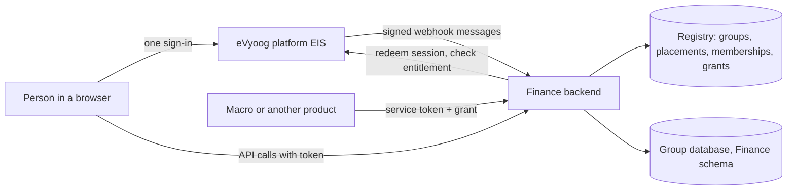

# Workflows: multi-tenancy and organization hierarchy (Finance)

Status: **Draft.** Each workflow describes what must happen once the [FRD](../../02-requirements/FRD/multi-tenancy-and-org-hierarchy/requirement.md) is built. The pieces that already exist in EIS, Agile and Macro are marked **(as built elsewhere)**; the Finance side is new. Diagrams are Mermaid and render on GitHub.

| File | Workflow | Requirements |
|---|---|---|
| [WF-01-group-onboarding.md](WF-01-group-onboarding.md) | A customer buys Finance: database, schema, migration, first snapshot, ready | REQ-GLT-001..004, 020..025 |
| [WF-02-sign-in-and-tenant-choice.md](WF-02-sign-in-and-tenant-choice.md) | A person opens Finance: platform session, tenant choice, the gate | REQ-GLT-010..016, 040..045, 065 |
| [WF-03-sign-out.md](WF-03-sign-out.md) | One sign-out: Finance, the platform, the other products | REQ-GLT-043 |
| [WF-04-hierarchy-sync.md](WF-04-hierarchy-sync.md) | A snapshot becomes Business Group, Legal Entities, Business Units and people; Finance completes its own attributes | REQ-GLT-030..037 |
| [WF-05-role-and-scope-check.md](WF-05-role-and-scope-check.md) | Every request: level, functional role, Legal Entity, reach | REQ-GLT-050..061 |
| [WF-06-service-to-service.md](WF-06-service-to-service.md) | Another product calls Finance for a group | REQ-GLT-013, 067 |
| [WF-07-subscription-lifecycle.md](WF-07-subscription-lifecycle.md) | Suspend, resume, expiry, cancel, deprovision | REQ-GLT-023, 065..068 |
| [WF-08-moving-an-existing-customer.md](WF-08-moving-an-existing-customer.md) | Orbinox and Unicon from the shared database into their own groups | REQ-GLT-005, 083 |

## The actors, in one picture

## Conventions

- "Gate" means the ordered checks of business rule BR-GLT-011.
- "Reach" means the Legal Entities and Business Units a person may read (BR-GLT-037).
- Every step that refuses names its code from BR-GLT-010.
