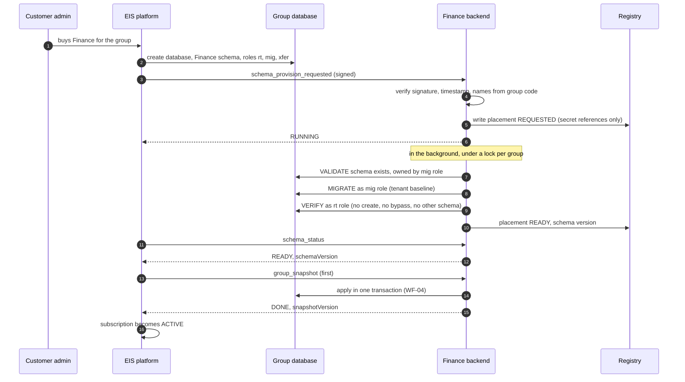

# WF-01: Group onboarding (a customer buys Finance)

Requirements: REQ-GLT-001..004, 020..025, 037. Rules: BR-GLT-002, 009, 012..016, 028.
Platform side **(as built elsewhere)**: EIS creates the database, the schema and the three roles, and sends the messages. Finance side: new.

## Steps

| # | Step | Detail | Refusal or failure |
|---|---|---|---|
| 1 | Message arrives | `POST /api/internal/platform/webhook`, four `X-EIS-*` headers | no secret `404`; bad or stale signature `401` |
| 2 | Names checked | Database, schema and roles are recomputed from the group code and the schema code, and must equal the message. Host, port and SSL come from Finance's own configuration, never from the message | mismatch: `200 {state: FAILED}`; nothing connects |
| 3 | Collision check | A group code equal to a hand-made (legacy) tenant is refused | `FAILED` |
| 4 | Placement recorded | `platform_group` and `platform_placement` rows; state REQUESTED; the password is a reference (`local:`, `aws:`), never a value | |
| 5 | Answer | `RUNNING` at once; the work continues in the background | |
| 6 | Validate | The schema exists and is owned by the migration role | `SCHEMA_MISSING`, `SCHEMA_NOT_OURS`: placement FAILED, failed step recorded |
| 7 | Migrate | All Finance migrations as the migration role, under an advisory lock for the group (a second instance answers `RUNNING`). The migrations use `"${flyway:defaultSchema}"` and create no other schema | failure: only this group is FAILED |
| 8 | Verify | As the runtime role: tables readable; not superuser, create-database, create-role, replication or bypass-row-security; cannot create in its own schema or in `public`; cannot use another product's schema | FAILED |
| 9 | Ready | Placement READY with the schema version. The platform asks `schema_status` and gets `READY` | |
| 10 | First snapshot | WF-04. The seeded default administrator is deactivated (BR-GLT-028). The subscription becomes ACTIVE only after the migration **and** the first snapshot | |
| 11 | Finance setup | The group's Finance administrator (platform Admin level) signs in and completes the Finance attributes (WF-04, step 7). Ledgers, calendars and accounts are created by Finance people, never by a snapshot | |

## What replaces today's cold start

Today a new Finance database needs a `SYS_ADMIN` role row inserted by hand (finding F-07) and an open setup wizard (F-08). In this workflow the first Admin comes from the snapshot, and no endpoint is open. The setup wizard may remain for the Finance-only part (ledger, calendar, chart of accounts) behind authentication and the group-level permission.

## Failure and retry

- The platform retries a snapshot at 1, 5, 15, 60 and 240 minutes, then stops; an operator sends it again.
- A group in FAILED does not affect other groups. A READY group keeps serving while a new migration runs.
- Re-sending `schema_provision_requested` is safe: it is idempotent per group.
