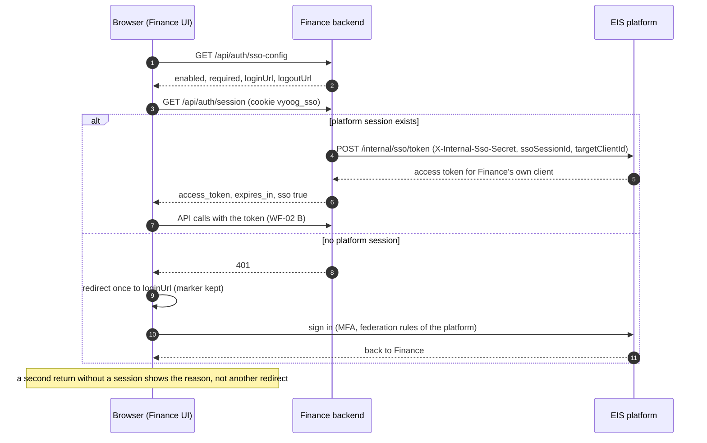
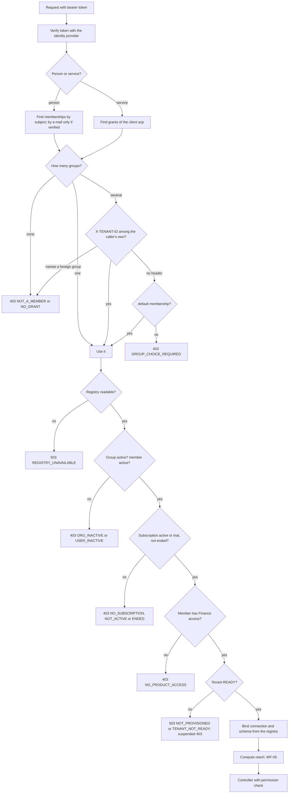

# WF-02: Sign-in and tenant choice

Requirements: REQ-GLT-010..016, 040..045, 065. Rules: BR-GLT-003..008, 011, 046..049.
Platform side **(as built elsewhere)**: EIS login, `vyoog_sso` cookie, `/internal/sso/token`. Finance side: new (today Finance has its own password login).

## A. Opening the application

| # | Step | Rule |
|---|---|---|
| 1 | The page asks `sso-config`. With `required: true` it shows no password form | BR-GLT-046 |
| 2 | It asks `GET /api/auth/session` once. Finance redeems the platform session backend to backend and never returns the cookie value | BR-GLT-047 |
| 3 | No session: one redirect to the platform login. The platform sends the person back only if the address's origin equals a catalog launch origin | BR-GLT-048 |
| 4 | Back without a usable session (for example a person with no membership): a message, no redirect | UI-GLT-003 |
| 5 | The token is for Finance's own identity client. Finance holds no password and no refresh token of its own | BR-GLT-046 |

## B. Every request: choosing the tenant and the gate

| # | Rule |
|---|---|
| 1 | The tenant never comes from the address, the host, the `Origin`, or a token claim that names a group (BR-GLT-003). |
| 2 | `X-TENANT-ID` chooses only among the caller's own groups. A foreign group answers like an unknown one (BR-GLT-004). |
| 3 | A person is matched by subject. E-mail only if the token says it is verified; the subject is stored on first match (BR-GLT-005). |
| 4 | The registry is read fail closed. Answers are cached at most 60 seconds, so a revoked access takes effect within a minute (BR-GLT-007). |
| 5 | Connection and schema come from the registry only, never from the request (BR-GLT-009). |
| 6 | Sign-in endpoints, branding, health and the webhook do not run the gate. |

## C. A person in several groups

The UI shows a group selector when `GET /api/v1/me/context` lists more than one group. The choice is sent as `X-TENANT-ID`. A person with no default and no choice gets `GROUP_CHOICE_REQUIRED` and the selector opens.

## D. What changes for Finance's existing people

Existing `auth.users` rows in a platform group are replaced by memberships. A person is created by the platform, never by "Add user" in Finance. Own-login, refresh, change-password and reset-password endpoints answer `403 platformSignIn` in a platform group (REQ-GLT-044).
