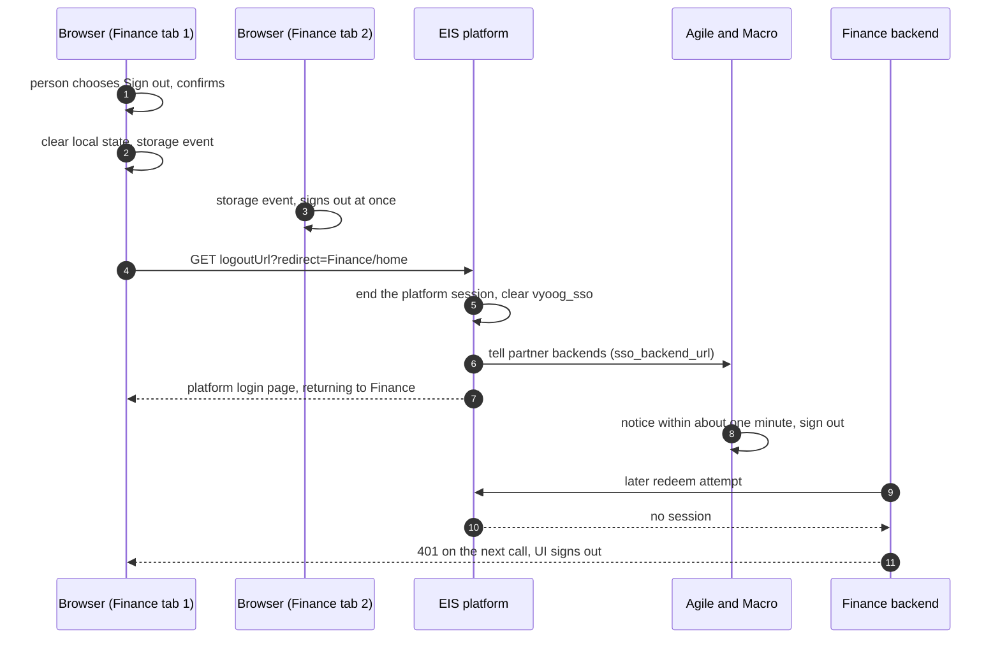

# WF-03: One sign-out

Requirements: REQ-GLT-043, 046. Rules: BR-GLT-048.
Platform side **(as built elsewhere)**: EIS `/signout`, `/internal/sso/logout`, partner propagation. Finance side: new.

| # | Step | Rule |
|---|---|---|
| 1 | Finance asks "Sign out of Finance?" with Stay as the default. | UI-GLT-004 |
| 2 | Finance clears its in-memory token and fires a browser `storage` event so other Finance tabs sign out at once. | UI-GLT-004 |
| 3 | The browser goes to `{logoutUrl}?redirect=<Finance>/home`. `logoutUrl` is `EIS_LOGOUT_URL`, or the origin of `EIS_LOGIN_URL` plus `/signout`. | BR-GLT-048 |
| 4 | The platform ends its session and informs partner backends. Other products sign out within about a minute (they check about once a minute) or on their next 401. | BR-GLT-048 |
| 5 | The platform opens its login page, returning to Finance only if the address's origin equals a catalog launch origin. | BR-GLT-048 |
| 6 | If the platform session ends elsewhere (another product, another device), Finance notices on the next minute check or on a 401 and signs out. | UI-GLT-005 |

Not closed (same as the other products): a direct password grant to the identity provider is still possible for a caller who knows it; `required` governs the screen only.
