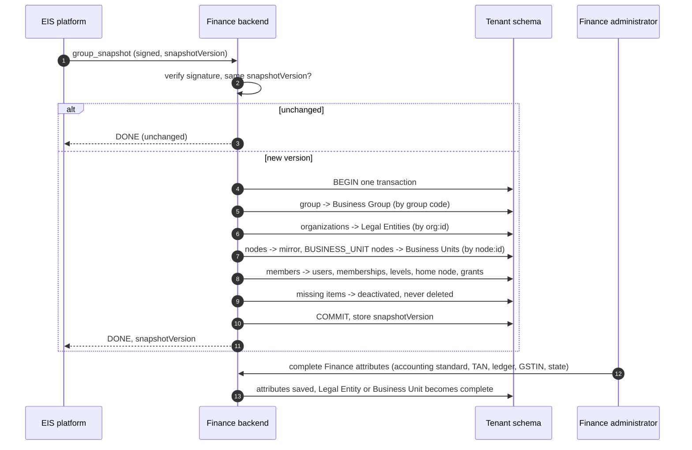

# WF-04: Hierarchy synchronization (snapshot to Business Group, Legal Entities, Business Units and people)

Requirements: REQ-GLT-030..037. Rules: BR-GLT-017..028, 030..035.
Platform side **(as built elsewhere)**: EIS builds the `group_snapshot` and resends it on change (within about 60 seconds), with retries. Finance side: new.

## What is created and from what

| Snapshot item | Finance result | Matched by | Finance-owned, filled later |
|---|---|---|---|
| `group` | one Business Group (and the Consumption Context row of the tenant) | group code | es mode, default currency |
| `organizations[]` | one Legal Entity each | `org:<id>` | accounting standard, TAN, ledger assignment |
| `nodes[]` of type BUSINESS_UNIT | one Business Unit each, directly under its Legal Entity | `node:<id>` | GSTIN, state code |
| other `nodes[]` | a row in the mirror only (for reach) | `node:<id>` | |
| `teams[]` | ignored | | |
| `members[]` | a person with a membership, level, home node, grants | subject, else e-mail | functional roles |
| `subscription` of each organization | plan, seats, end date, status for the gate | | |

## Steps

| # | Step | Rule |
|---|---|---|
| 1 | The signature and timestamp are verified. The same `snapshotVersion` as the last accepted answers "unchanged" and writes nothing. | BR-GLT-013 |
| 2 | One transaction. Anything that fails rolls the whole snapshot back and answers `FAILED` with a detail; the platform retries. | REQ-GLT-030 |
| 3 | Structure is written: Business Group, Legal Entities, mirror, Business Units. Each row keeps its platform reference so the next snapshot updates the same row. A node whose parent has not arrived yet waits (a pending parent reference) and a cycle is refused. | BR-GLT-021, 022 |
| 4 | Only a node of type ORGANIZATION with no parent is a root. (A past bug lost the first unit under an organization by merging it as a root.) | lesson 6 of the reference model |
| 5 | People are written by subject; a person without a subject is matched by e-mail and the subject is filled at first sign-in. Levels, home node and unit-scoped grants (source PLATFORM) follow the snapshot every time. A functional role given in Finance is applied only when the person is new or the platform changes the level. | BR-GLT-030, 034 |
| 6 | What is missing is **deactivated, never deleted**: Legal Entities, Business Units, people, memberships and grants of source PLATFORM. Grants of source FINANCE are never touched. | BR-GLT-018 |
| 7 | New Legal Entities and Business Units are marked **incomplete**. A Finance administrator of the group (or of that Legal Entity) completes the Finance attributes. Until then: a Legal Entity cannot post journals; a Business Unit cannot carry GST transactions. | BR-GLT-023 |
| 8 | A snapshot with no `levels` (older platform) may add organizations, units and people but does not change levels, home units or grants, and does not deactivate anything it cannot see. | BR-GLT-019 |
| 9 | No ledger, calendar, account, dimension, journal or balance is ever created by a snapshot. | BR-GLT-019 |
| 10 | The first snapshot deactivates the seeded default administrator. | BR-GLT-028 |

## Cases

| Case | Result |
|---|---|
| A second organization arrives in a Thin ES group | Applied. The Business Group is marked "needs Thick ES"; posting on the extra Legal Entity is blocked until a Finance administrator switches the mode (BR-GLT-025) |
| A Business Unit node is nested under a Division | Business Unit directly under the Legal Entity; the path is in the mirror |
| An organization disappears | Its Legal Entity is deactivated; posted journals and balances stay and remain readable by those with reach |
| A unit is renamed in the platform | The Business Unit's name follows; its GSTIN and state stay |
| Someone tries to rename a Legal Entity in Finance | `409 PLATFORM_MANAGED` |
| Two platforms send snapshots to the same group | The older one (no `levels`) cannot reset levels (BR-GLT-019) |
