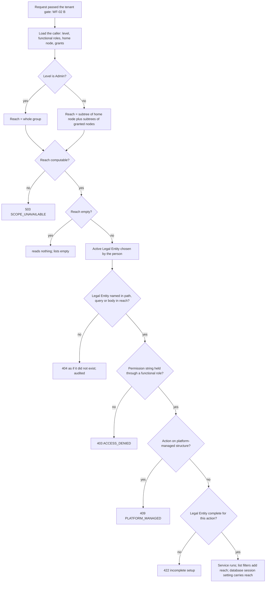

# WF-05: Role and scope check on every request

Requirements: REQ-GLT-050..061, 067, 072. Rules: BR-GLT-030..045, 056.
Platform side **(as built elsewhere)**: levels and reach in Agile and Macro. Finance side: new. This workflow closes findings F-02, F-03 and F-14.

## Steps

| # | Step | Rule |
|---|---|---|
| 1 | The server loads the person's level, functional roles, home node and grants from live data. A role or Legal Entity sent by the browser is a request, not a fact. | BR-GLT-036 |
| 2 | Reach is computed: Admin level reaches the whole group; others reach the subtree of their home node plus the subtrees of nodes given to them. The nodes map to Legal Entities and Business Units through the mirror. | BR-GLT-037 |
| 3 | If reach cannot be computed (registry or mirror unreadable): `503 SCOPE_UNAVAILABLE`. A person with no home node and no grant reads nothing. | BR-GLT-038 |
| 4 | **The Legal Entity of the request is checked.** The id in the path, query or body must be in reach. Out of reach answers `404`, the same as an id that does not exist, and the refusal is audited. This is the fix for finding F-02. | BR-GLT-040 |
| 5 | Every list adds reach to its query. A list called with no filter returns what is in reach, never every row. This is the fix for finding F-03. | BR-GLT-040 |
| 6 | The permission string is checked, as today (`gl:journal:approve`...). It is held through the person's Finance functional role. The level decides where; the functional role decides what. | BR-GLT-032 |
| 7 | An action on platform-managed structure is refused (`409 PLATFORM_MANAGED`); Finance-owned attributes are allowed. | BR-GLT-024 |
| 8 | An incomplete Legal Entity or Business Unit blocks only the actions of BR-GLT-023. | BR-GLT-023 |
| 9 | The database session carries the reach (`app.scope_units` style setting) so row-level security gives a second line of defence. | BR-GLT-043 |

## The five levels in Finance

| Level | Reach | Finance actions |
|---|---|---|
| Admin | whole group | group-wide setup: Business Group attributes, every Legal Entity's setup, users, grants, roles; may give the Admin level only by the platform |
| Organization admin | one Legal Entity and its Business Units | that Legal Entity's setup (ledger, calendar, COA structure, dimensions, periods, approval policy) and its people; cannot touch group-wide setup |
| Unit admin | one Business Unit | that Business Unit's attributes (GSTIN, state), inventory organisations, and its people |
| Team Lead | their unit | as User; no extra Finance right |
| User | their unit | what the functional role allows (post, approve, view, audit) |

## Choosing the active Legal Entity

A person with roles in several Legal Entities picks one in the top bar. The choice is sent with each request and checked against reach (REQ-GLT-057). A token never fixes the Legal Entity for its life: today the JWT claim `legalEntityId` is read only at login, and that is replaced.

## Granting extra reach

An administrator may give a person an extra Legal Entity or Business Unit inside their own reach, and remove it. A grant that came from the platform shows "remove it in eVyoog" and is not removable here (`409`). The person's reach is visible to them ("My access") and to administrators ("Access").

## Audit

Every refusal by scope is written to the audit log with the group, the person and the Legal Entity asked for (REQ-GLT-072). Hierarchy, role and grant changes are audited in the same transaction as the change.
