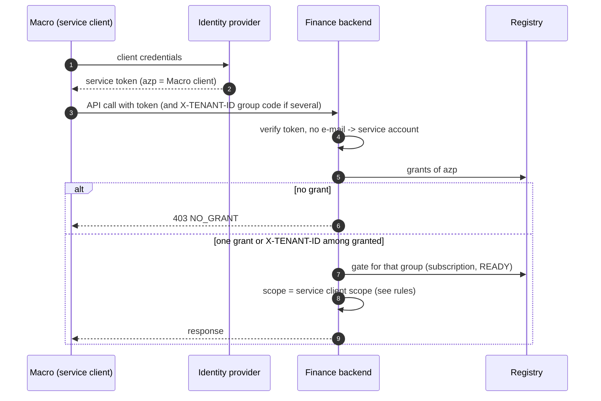

# WF-06: Another product calls Finance (service to service)

Requirements: REQ-GLT-013, 067. Rules: BR-GLT-006, 053.
Platform side **(as built elsewhere)**: `tenant_service_grant`, one identity-provider service client per product (Macro and Agile today share a shared-secret mechanism that is on the backlog to replace). Finance side: new. Today Finance has no service-to-service path at all.

| # | Rule |
|---|---|
| 1 | A service token has no e-mail and a client id. Finance treats it as a service account and never as a person. |
| 2 | The groups it may act for are the rows of `platform_service_grant` for its client (`azp`). No grant: `403 NO_GRANT`. One: that group. Several: `X-TENANT-ID` among the granted ones; with no header, the primary tenant if it is granted, else refuse. |
| 3 | The gate still applies for the group (active, subscription, READY). A grant gives no access to a group that is not subscribed. |
| 4 | **Scope of a service client.** In Agile a service client is unlimited inside its group; in Macro likewise for tools. Finance should not copy this blindly: a service client gets only the Finance endpoints its client is allowed (an allow-list of paths and of Legal Entities per grant). *Decision D-08 in the plan.* |
| 5 | A service client never creates people, groups, Legal Entities or Business Units. |
| 6 | Grants come from the platform (messages or the registry), not from Finance's own tables. In Agile a missing grant is healed at request time when the group has listed the client and connected the product; Finance does not need this on day one. |
| 7 | Scheduled jobs run for each tenant listed by the registry, never as a service client with unlimited reach by accident (WF-07 and REQ-GLT-075). |
