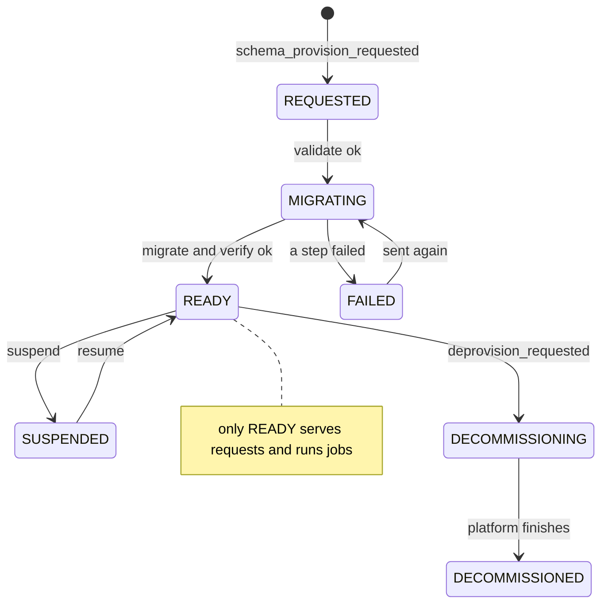
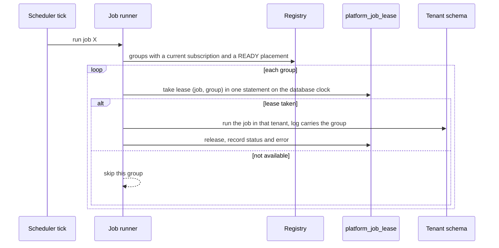

# WF-07: Subscription lifecycle and scheduled jobs

Requirements: REQ-GLT-023, 065..069, 075, 076. Rules: BR-GLT-015, 050..054, 057.
Platform side **(as built elsewhere)**: EIS owns the subscription and sends `provision_requested`, `suspend`, `resume`, `deprovision_requested`; the end date travels in the snapshot. Finance side: new.

| Event | Finance does | Never does |
|---|---|---|
| `provision_requested` | records the subscription; acknowledges | create data |
| `suspend` | tenant SUSPENDED atomically; every call answers `403 TENANT_UNAVAILABLE` or `SUBSCRIPTION_NOT_ACTIVE`; jobs skip it | touch data |
| `resume` | back to READY | |
| End date reached (from the snapshot) | the next request answers `403 SUBSCRIPTION_ENDED`; checked on **every** request, not only at sign-in. The end is the end date at `23:59:00.000 +05:30` | restart or redeploy needed |
| Term ended with grace | access mode READ_ONLY: reads allowed, writes refused | |
| `deprovision_requested` | acknowledged; tenant stops serving | delete the schema or any data (the platform decides retention; Finance never deletes) |
| Registry or entitlement unreadable | `503`, fail closed | serve from a default |

## Scheduled jobs per tenant

Finance's scheduled work (recurring journal generation, import retries, any period job) runs once per tenant.

| # | Rule |
|---|---|
| 1 | A group with an ended subscription, or a tenant not READY, is skipped. |
| 2 | The lease is one atomic statement on the **database** clock (not each instance's clock): free when `leased_until` has passed and the minimum gap since the last start has passed. |
| 3 | A run longer than 15 minutes loses its lease (a crash expires it); only the holder can release it. |
| 4 | A failure in one tenant is logged with the group, its status is FAILED with the error cut to 500 characters, the lease is released and the other tenants continue. |
| 5 | If no lease can be taken: in a routed setup the tenant is skipped; with no lease table (legacy single tenant) the job runs as today. |
| 6 | A job never runs as an unlimited service client; it runs inside one tenant with that tenant's connection. |
