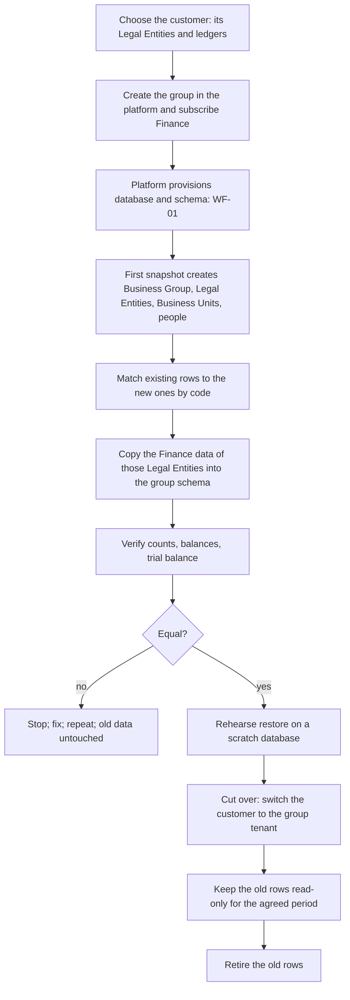

# WF-08: Moving an existing customer into its own group

Requirements: REQ-GLT-005, 083. Applies to the data that already exists in the shared database `vygmicroservice` (the Orbinox demo company and the Unicon Engineers set-up, both in the `gl`, `aie` and `auth` schemas).
Platform side **(as built elsewhere)**: Agile and Macro removed their adoption tooling in CR-222 and now do this as a written runbook (`deployment/multi-tenancy-cutover.md` in Agile), with a restore rehearsal script. Finance should do the same: a runbook, not a product feature.

| # | Step | Detail |
|---|---|---|
| 1 | Inventory | For each customer, list its Business Group, Legal Entities, ledgers, calendars, chart of accounts, dimensions, journals, balances, approval policies, users and roles. Orbinox and Unicon are distinct customers today only by Legal Entity; the shared tables mix them (findings F-01, F-14). |
| 2 | Create the group | In the platform, with the organizations as Legal Entities and the business-unit nodes as Business Units, and Finance subscribed. |
| 3 | Provision | WF-01. The group's schema is empty and migrated to the tenant baseline. |
| 4 | Match | Existing Legal Entity and Business Unit codes are matched to the ones the snapshot created, by code. A code with no match is listed and decided by a person; nothing is guessed. |
| 5 | Copy | The Finance data of those Legal Entities is copied into the group schema with ids kept (UUID keys make this safe). Foreign keys to `gl.*`, `aie.*` and `auth.*` become references inside the one schema. |
| 6 | People | Existing `auth.users` are matched to platform members by e-mail (verified) and get the subject at first sign-in. Their Finance functional roles are kept. Password hashes are not copied. |
| 7 | Verify | Row counts per table, the trial balance of every open period, account balances and journal numbers must equal before and after. A restore rehearsal on a scratch database passes. |
| 8 | Cut over | The registry placement is switched; the legacy tenant stops serving that customer. The step is reversible until the old rows are retired. |
| 9 | Retire | After the agreed period, the old rows are removed by a person, with a backup. |

Rules: a customer is never moved while a period close or a posting run is in progress; journal numbers and period status move with their Legal Entity; the audit log moves with its rows and is never rewritten.

Not claimed: this has not been rehearsed for Finance. Agile's equivalent rehearsal reported 87 tables equal on a scratch database; Finance has 46.
