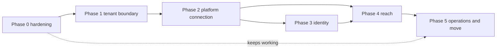

# Gap analysis and adoption plan: Finance (GL) onto the platform tenancy model

Status: **Draft for Domain SME review.** Based on [finance-current-state.md](finance-current-state.md) (findings F-01 to F-18) and the [reference model](platform-reference-model.md). Requirements are in the [FRD](../../02-requirements/FRD/multi-tenancy-and-org-hierarchy/requirement.md). Sizes are relative (S, M, L, XL), not dates: no estimate in this repository has been calibrated for Finance.

## 1. The gap in one table

| Area | Platform model (EIS, Agile, Macro) | Finance today | Gap | Phase |
|---|---|---|---|---|
| Tenant boundary | database per group, schema per product | one shared database, schemas `gl`, `aie`, `auth` | no tenant concept (F-01) | 1 |
| Tenant choice | by verified membership or grant, never by address | none | missing (F-01) | 1 |
| Data scoping | reach checked on the server for every Legal Entity and list | JWT carries a Legal Entity; data endpoints trust the id sent; lists return every row | **open data exposure** (F-02, F-03, F-14) | **0**, then 4 |
| Identity | one sign-in through the platform | own users, bcrypt hashes, own JWT | missing (F-06, F-15, F-16) | 3 |
| Structure master | platform writes; product read-only | Finance creates its own hierarchy and people | missing (F-07, F-10) | 2 |
| Provisioning | platform creates the database and schema; product migrates and verifies | cold start by hand-written SQL; open setup wizard | missing (F-07, F-08) | 1, 2 |
| Roles | five levels plus product roles | Finance roles, per Legal Entity, no level | partly there (roles are data, scoped per Legal Entity) | 3 |
| Entitlement | subscription, end date, product access, on every request | none | missing (F-11) | 2 |
| Audit identity | the verified person | `X-User-Id` header, default `system` | **trust gap** (F-04) | **0** |
| Jobs | one run per tenant, leased | none per tenant | missing | 5 |
| Secrets | references only | a database password written in `CLAUDE.md` | **exposed** (F-09) | **0** |
| Frontend | context from the signed-in person | hard-coded Business Group, tokens in `localStorage`, own login screens | missing (F-13, F-15, F-16, F-17) | 0, 3, 4 |

## 2. What this needs from the codebase (sizing facts)

| Fact | Value | Source |
|---|---|---|
| Tables | 46: 32 in `gl`, 7 in `aie`, 7 in `auth`; no table name appears in two schemas, so they can live in one schema | migrations V1..V35 |
| JPA entities with a hard-coded schema | 44 (`@Table(schema = ...)`: 30 gl, 7 aie, 7 auth) | `src/main/java` |
| Schema-qualified references in migrations | 437 (352 `gl.`, 50 `auth.`, 35 `aie.`) | `db/migration` |
| Native queries naming a schema | 2 files | `src/main/java` |
| REST endpoints | about 150 under `/api/v1` | controllers |
| Controllers taking a Legal Entity id | 74 lines | controllers |
| Controllers reading `X-User-Id` | 71 uses | controllers |
| Migrations | V1..V35 (one per capability); applied migrations cannot be edited | Flyway |

Consequence: the existing migrations name `gl.`, `aie.` and `auth.` literally and create the `auth` schema. They cannot run in a per-group schema as they are, and they cannot be edited once applied. A **new tenant baseline** is needed: a second migration tree (for example `db/tenant/`) generated from the final state of the three schemas, with no literal schema (`"${flyway:defaultSchema}"`), run as the migration role for each group. The existing tree keeps serving the legacy shared database until the last customer has moved. Macro did the same (a control tree and a tenant tree).

## 3. Phases

### Phase 0: close the open exposures (no platform needed; do first)

These are weaknesses today, with one customer and a demo that already holds two companies.

| Item | What | Size |
|---|---|---|
| 0.1 | **Check the caller's Legal Entity on every request** using the data Finance already has: `auth.user_roles (user_id, role_id, legal_entity_id)`. A request or path naming a Legal Entity the caller has no role in answers `404`. List endpoints filter to the caller's Legal Entities. One interceptor or service, applied to the 74 controller entry points, with tests that fail today (AC-GLT-050, 051) | L |
| 0.2 | Take the audit actor from the token subject; ignore `X-User-Id` | S |
| 0.3 | Put the setup wizard behind authentication and a group-level permission | S |
| 0.4 | Refuse a login that names a Legal Entity the person has no role in | S |
| 0.5 | Rotate the database password; remove it from `CLAUDE.md`; use a secret reference | S |
| 0.6 | Remove the stray files `FROM`, `JOIN`, `SELECT`, `WHERE`, `http`, `import`, `main` | S |
| 0.7 | Frontend: remove the hard-coded Business Group id (read it from the context) | S |

Exit: AC-GLT-050, 051, 070, 090, 091, 092, 093 pass. Phase 0 is independent of every later phase and every later phase keeps it.

### Phase 1: tenant boundary

| Item | What | Size |
|---|---|---|
| 1.1 | Tenant baseline migration tree (one schema, no literal schema names); generated from the final state of `gl`, `aie` and `auth`; checked equal to the old tree on a scratch database | XL |
| 1.2 | Entity mapping without a fixed schema (a default schema supplied per tenant connection); native queries without literal schema | L |
| 1.3 | Registry: the ten `platform_*` tables and their migration tree (decision D-07 on where it lives) | M |
| 1.4 | Routing data source or Hibernate multi-tenancy, per tenant pool opened on first use and closed when idle; registry read on its own connection | L |
| 1.5 | Tenant filter and the gate of WF-02 B, with mode SINGLE (default, today's behaviour) and ROUTED; fail closed; cache 60 s | L |
| 1.6 | Runtime, migration and (later) transfer database roles; verification of the runtime role | M |

Exit: AC-GLT-001..006, 010..016 pass on two Testcontainers tenants; mode SINGLE leaves today's customer unaffected.

### Phase 2: platform connection and hierarchy

| Item | What | Size |
|---|---|---|
| 2.1 | Webhook endpoint, signature check, idempotency, state answers | M |
| 2.2 | Provisioning: validate, migrate (lock per group), verify, mark READY | L |
| 2.3 | Snapshot applier: Business Group, Legal Entities, Business Units, mirror, people, memberships, grants; deactivate, never delete | XL |
| 2.4 | Finance-owned attributes, "incomplete" flags and gates; the "needs Thick ES" marker | M |
| 2.5 | `PLATFORM_MANAGED` guard on structure endpoints | M |
| 2.6 | Subscription and entitlement gate, capabilities per plan | M |
| 2.7 | Product catalog entry (product code, schema code, webhook, SSO and launch URLs) agreed with the platform team | S |

Exit: AC-GLT-017, 018, 020..026, 030..039 pass; a group is provisioned from a signed message with no SQL (staging).

### Phase 3: identity

| Item | What | Size |
|---|---|---|
| 3.1 | Resource server for the platform's identity provider; stop issuing own tokens in platform groups | L |
| 3.2 | `sso-config` and `session` endpoints; redemption backend to backend | M |
| 3.3 | Level mapping (role map), functional roles assigned within reach, last-admin rule | L |
| 3.4 | Remove own login, change-password, reset-password and "Add user" in platform groups | M |
| 3.5 | Frontend: sign-in, sign-out, group and Legal Entity context, tokens out of `localStorage` | L |

Exit: AC-GLT-040..046, 058, 059 pass; one sign-in and one sign-out verified with Agile and Macro (staging; Keycloak token-exchange permissions must exist first).

### Phase 4: reach

| Item | What | Size |
|---|---|---|
| 4.1 | Scope resolver (home node subtree plus grants; Admin reaches the group); fail closed | L |
| 4.2 | Active Legal Entity selected by the person and checked on every request (replaces the login claim) | M |
| 4.3 | Reach applied to every list and every by-id read and write (replaces the Phase 0 check) | XL |
| 4.4 | Row-level security on Legal-Entity-scoped tables, session setting per request | L |
| 4.5 | Extra grants, access overview, "My access" | M |
| 4.6 | Frontend: selector, Access screen, My access screen | M |

Exit: AC-GLT-050..060 pass.

### Phase 5: operations and moving the existing customers

| Item | What | Size |
|---|---|---|
| 5.1 | Scheduled jobs per tenant with a lease | M |
| 5.2 | Metrics and a group in every log line | S |
| 5.3 | Isolation suite and load run (two tenants, real HTTP, own non-superuser roles) | L |
| 5.4 | Runbook and restore rehearsal for Orbinox and Unicon (WF-08) | L |
| 5.5 | Cut-over, then retire the old rows | M |

Exit: AC-GLT-070..075, 095 pass.

## 4. Order and dependencies

- Phase 0 can start now and needs nobody else.
- Phase 1 needs the tenant baseline; do it before more capabilities are added, because every new migration written in the old style adds work to 1.1.
- Phase 2 needs the platform team to add Finance to the catalog (2.7) and to provide the secrets.
- Phase 3 needs Keycloak permissions for the token exchange; no product has verified these yet.
- The DEBT items (dimension type collision, ledger sharing, calendar sharing, ledger status) change tables that the tenant baseline copies. If they are done first, the baseline starts from their final shape; if after, each needs a tenant migration as well as a legacy one. Recommendation: settle the schema-changing debts (DEBT-01, 04, 05, 06) **before** Phase 1.1, or accept doing each twice.

## 5. Decisions needed

| ID | Decision | Recommendation |
|---|---|---|
| D-01 to D-06 | Hierarchy mapping decisions | See [hierarchy-mapping.md](hierarchy-mapping.md), section 7 |
| D-07 | Where the registry lives: a control schema in each environment's database (Macro: `platform_control`) or in the application's own schema (Agile) | A control schema with its own migration tree, as Macro, so a group's schema never holds registry data |
| D-08 | What a service client may do in Finance | An allow-list of paths and of Legal Entities per grant; not unlimited like Agile and Macro tool clients |
| D-09 | One schema per group for all of Finance (merging `gl`, `aie`, `auth`) | Yes; the platform contract gives one schema per product per group. Needs the tenant baseline of 1.1 |
| D-10 | Update `CLAUDE.md`: "not microservices, one database" and "write only to `gl.*` and `aie.*`" become "capability-based service of the platform; one database per group; write only to Finance's own schema". `CLAUDE.md` is authoritative and says not to deviate without the Domain SME | The Domain SME decides; this plan does not edit it |
| D-11 | Database and schema names | Do not hard-code a pattern. The platform's documents and code disagree (`eis_<group>` and `vyg_*` against `<group>_db` and `<schemaCode>_<group>`); Finance recomputes the names from the group code and compares them to the message, as Agile and Macro do |
| D-12 | Order against the capability build queue in `CLAUDE.md` (its "next to build" list is out of date) | Update the build position, then slot Phase 0 first, Phase 1 before the next capability that adds migrations |
| D-13 | Whether a legacy tenant keeps the local login for `SYS_ADMIN` during the move | Yes, until the last customer has moved, and only in the legacy tenant |
| D-14 | Whether Finance's `consumption_context` stays or is replaced by the registry's group row | Keep it as Finance's customer record, created by provisioning, one per tenant database |

## 6. Risks

| Risk | Why | Mitigation |
|---|---|---|
| The tenant baseline drifts from the legacy migrations | two trees describing the same tables | generate the baseline from the legacy result; a test that compares the two schemas on a scratch database |
| Reach is added late and the Phase 0 check is mistaken for the final design | Phase 0 uses `auth.user_roles` per Legal Entity; the platform model uses nodes | name Phase 0 an interim control; AC-GLT-050..060 stay the exit test for Phase 4 |
| A snapshot overwrites a Finance attribute | two writers | the split in the hierarchy mapping; tests that send a snapshot and assert Finance attributes are unchanged |
| An unverified e-mail links a person to the wrong membership | Agile still matches unverified e-mails | BR-GLT-005 follows Macro |
| Half-changed entity flushed by a query | has happened in Agile (board rename) and in Finance (V30b) | BR-GLT-066 and a review point on every service method that mutates then queries |
| Posting engine regression | the engine is load-bearing and many tests depend on it | no change to its logic; the tenant context is below it and reach checks are above it |
| Nothing verified on real Keycloak, platform or RDS | same as the other three products | staging rehearsal before any customer |

## 7. What not to do (from the other three products)

- Do not choose the tenant from the address, the host, a claim or a header the caller controls.
- Do not let a message name a host, database, schema or password.
- Do not delete what a snapshot no longer lists; deactivate it.
- Do not create business records from a snapshot.
- Do not read the registry on the tenant's connection inside a transaction.
- Do not put a literal schema name in a new migration.
- Do not rely on the first query after a half-made change (flush).
- Do not treat a missing registry as permission to use a default tenant.
- Do not write Finance's accounting attributes from the platform, and do not let the platform's team level or cost-centre node stand in for Finance's dimensions.
